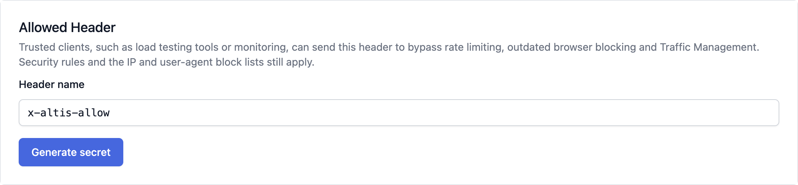
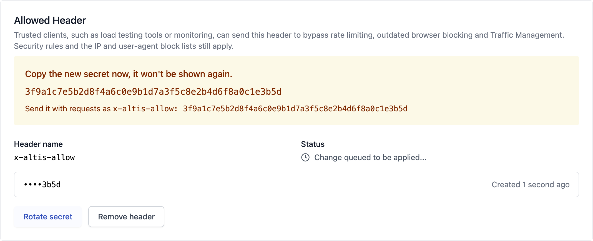
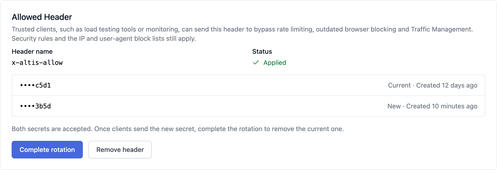

# Allowed Header

The **Allowed Header** feature allows administrators to let trusted clients, such as load testing tools or
uptime monitors, skip traffic controls by sending a secret HTTP header with their requests.

For more information on the WAF and default protections, see the [Firewall documentation](docs://cloud/firewall/).
To manage access by IP address or user agent instead, see [IP Access Control](./access-control.md) or
[User-Agent Access Control](./ua-access-control.md).

## Feature Overview

Requests that send the header with a valid secret skip:

- The [CDN-level rate limits](./README.md#protection-against-request-floods--denial-of-service-attacks).
- The outdated-browser restrictions, when enabled.
- [Traffic Management](./traffic-management.md) bot rules.

These requests are **still checked** by the IP and user-agent blocklists, the
[managed exploit protections](./README.md#protection-against-exploits), and the login page and per-container
rate limits.

> **Warning:** Anyone with the secret skips the same protections. Store it securely, and rotate it if it
> may have been exposed.

## Adding the Header

1. Navigate to **Firewall → Allowed Header** in the Altis Dashboard.
2. Enter a **Header name**, or keep the default `x-altis-allow`.
3. Click **Generate secret**.



Copy the secret, as it is only shown once. The header is accepted once the status shows **Applied**, which
usually takes a few minutes.



Send the header with each request:

```sh
curl -H "x-altis-allow: <secret>" https://example.com/
```

## Rotating the Secret

1. Click **Rotate secret**, and copy the new secret.
2. Once the status shows **Applied**, both secrets are accepted. Update your clients to send the new secret.
3. Click **Complete rotation** to remove the old secret.



## Removing the Header

1. Click **Remove header**.
2. Confirm the removal when prompted.

## Limits

- One header per environment, with up to two secrets during a rotation.
- Header names can be at most **64** lowercase letters, numbers and dashes.
- `authorization`, `cookie`, `host`, `user-agent` and `x-forwarded-for` can't be used.
- Secrets are case-sensitive and must match exactly.

## Related Documentation

- [Firewall and Rate Limiting](docs://cloud/firewall/)
- [IP Access Control](./access-control.md)
- [User-Agent Access Control](./ua-access-control.md)
- [Traffic Management](./traffic-management.md)
