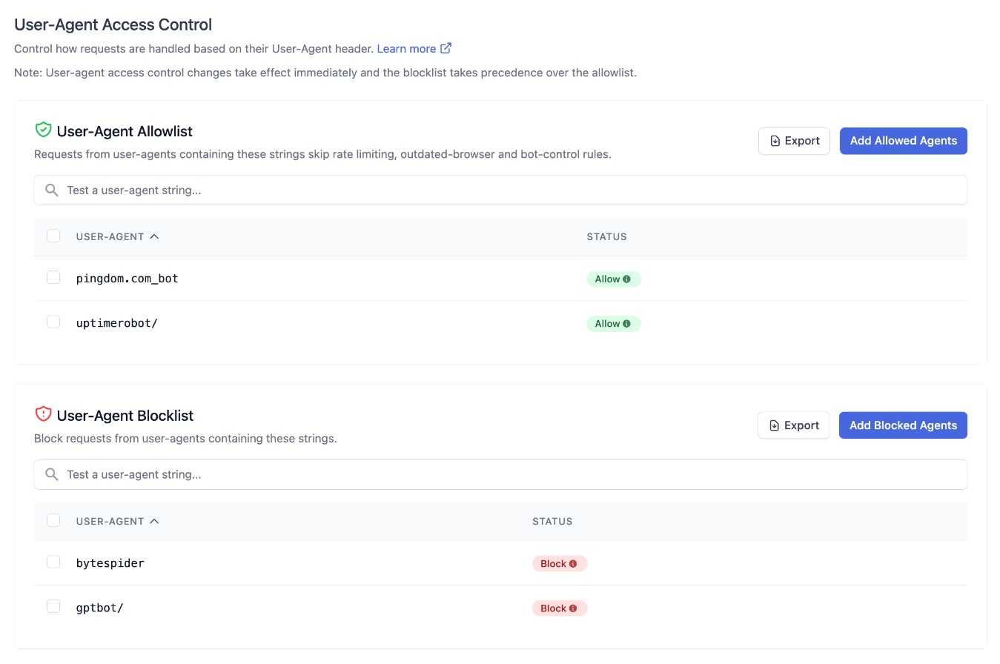
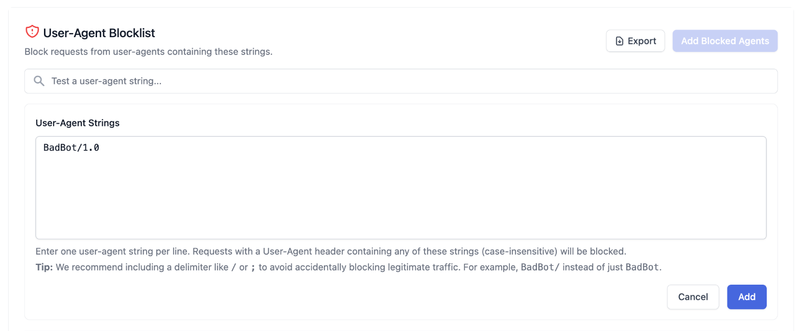
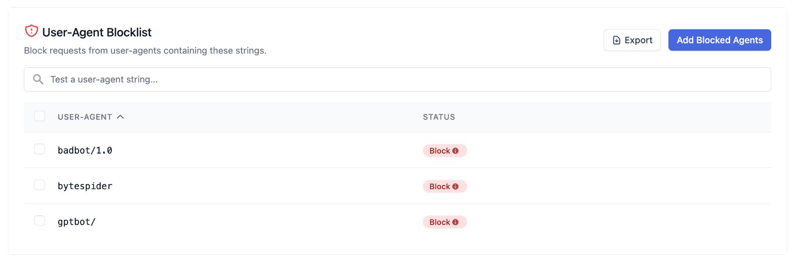
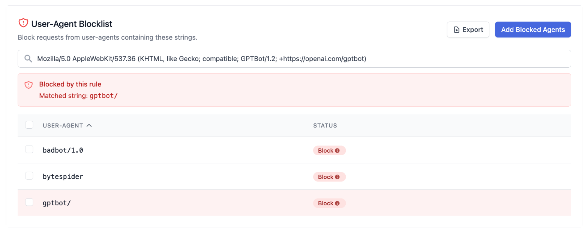
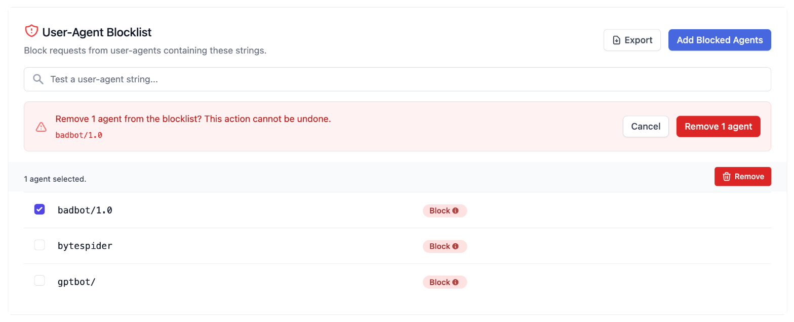

# User-Agent Access Control

The **User-Agent Access Control** feature allows administrators to manage how requests
are handled based on the `user-agent` header they send. It complements the default Web
Application Firewall (WAF) protections with two lists:

- **Blocklist**: block unwanted clients, such as crawlers, scrapers, or AI bots, from
  reaching your application.
- **Allowlist**: let trusted clients, such as uptime monitors or partner integrations,
  skip rate limits and bot protections that would otherwise slow them down or block them.

For more information on the WAF and default protections, see the [Firewall documentation](docs://cloud/firewall/).
To manage access at the IP address level instead, see [IP Access Control](./access-control.md).

## Feature Overview

- Match traffic whose `user-agent` header **contains** a string you specify.
- Manage both lists from the Altis Dashboard, with no code or configuration changes required.
- Changes take effect **immediately**.

This feature is accessible from the Altis Dashboard under **User-Agent Access Control**,
and is designed for simple, effective control over automated traffic.

## How Matching Works

Each entry in either list is a plain text string. Every incoming request is inspected and
compared against your entries.

- **Substring match.** An entry matches if it appears *anywhere* within the
  `user-agent` header. For example, the entry `bytespider` matches the user agent
  `Mozilla/5.0 (compatible; Bytespider; ...)`.
- **Case-insensitive.** The casing of your entry does not matter: `BadBot`,
  `badbot`, and `BADBOT` all behave identically. (Entries are stored and shown in lower case.)
- **Any match applies.** A request is matched by a list if its user agent matches any one of
  that list's entries.

## Blocklist

If a request's `user-agent` header matches an entry in the blocklist, the request is
rejected at the CDN/WAF edge with an HTTP `403 Forbidden` response and never reaches your
application.

Common use cases include:

- Blocking AI training and scraping bots (e.g. `GPTBot`, `Bytespider`, `ClaudeBot`).
- Blocking poorly-behaved crawlers that ignore `robots.txt` or generate excessive load.
- Blocking scripted clients and tools you don't want accessing the site.

> **Note:** Avoid entries that appear in ordinary browser user agents, such as `Mozilla`,
> `Chrome`, `Safari` or `AppleWebKit`. Because entries match anywhere in the header, these
> would block every visitor using that browser.

See [Best Practices](#best-practices) for choosing entries.

## Allowlist

If a request's `user-agent` header matches an entry in the allowlist, the request skips:

- The [CDN-level and login page rate limits](./README.md#protection-against-request-floods--denial-of-service-attacks),
  including the stricter limits on `wp-login.php` and `xmlrpc.php`.
- The outdated-browser restrictions, where enabled for your environment. These challenge or
  block requests claiming a browser version more than about a year old.
- [Traffic Management](./traffic-management.md) bot rules.

Allowlisted requests are **still checked** by the blocklist, the IP blocklist, and the
[managed exploit protections](./README.md#protection-against-exploits). Only traffic controls
are bypassed, not security controls. They are also still subject to the
[per-container rate limits](./README.md#protection-against-request-floods--denial-of-service-attacks)
on each application container, and to the Node.js request rate limit on Node.js applications.

Common use cases include:

- Uptime and performance monitors that would otherwise trip rate limits.
- Partner or internal integrations that send a distinctive `user-agent`.
- Legacy clients that are caught by the outdated-browser restrictions.

> **Warning:** The `user-agent` header is set by the client and can easily be faked. Anyone
> who copies an allowlisted string into their own requests will skip the same protections.
> Where the client has a fixed set of IP addresses, use the
> [IP Access Control](./access-control.md) allowlist instead, which cannot be spoofed.

See [Best Practices](#best-practices) for choosing entries.

## Precedence

The blocklist takes precedence over the allowlist. A request that matches both lists is
blocked.

An entry can't be added if it overlaps an entry on the other list in a way that would stop the
allowlist entry from working. For example, `bot` can't be added to the blocklist while `uptimebot/`
is on the allowlist, because every request matching `uptimebot/` also matches `bot` and would be
blocked. The same check stops `uptimebot/` being added to the allowlist while `bot` is on the
blocklist, and stops the same string being added to both lists. To change a conflicting entry,
remove it from the other list first.

The reverse is allowed: a blocklist entry such as `badbot/1.0` can sit alongside an allowlist entry
such as `bot`, because requests matching `bot` but not `badbot/1.0` are still allowlisted.

## Limits

- Each entry can be at most **200 characters**.
- Entries are escaped before being stored, which adds a character for each special
  character (such as `.`, `(`, `)` or `-`). An escaped entry must be at most 200 characters.
- Each list holds roughly **2,000 characters** of escaped entries in total. The dashboard
  shows an error when a change would exceed this.

## Adding an Entry

1. Navigate to the **User-Agent Access Control** section in the Altis Dashboard.
2. Click **Add Allowed Agents** or **Add Blocked Agents** on the list you want to change.
3. In the **User-Agent Strings** box, enter one `user-agent` string per line.
4. Click **Add**.

The new entries appear in the list with an **Allow** or **Block** status.

## Testing an Entry

Use the **Test a user-agent string…** box at the top of each list to check whether a given
user agent matches your current entries. Paste a full `user-agent` value to confirm that the
list matches the clients you intend, and does not match ones you don't, before relying on it.

When testing the allowlist, a user agent that also matches a blocklist entry is shown as blocked,
because the blocklist takes precedence.

## Removing an Entry

1. In the list, tick the checkbox next to each entry you want to remove.
2. Click **Remove** in the bar that appears above the list.
3. Review the confirmation banner and click **Remove *N* agent** to confirm.

> **Note:** Removing an entry cannot be undone. If you remove one by mistake, add it
> again using the steps above.

## Exporting a List

Click **Export** on a list to download its entries as a text file, with one entry per line.

## Best Practices

- **Use the shortest distinctive part of the user agent.** Entries match anywhere in the
  header, so the full string is rarely needed, and short entries leave room for more within
  the [limits](#limits). For example, instead of

  `Mozilla/5.0 (Windows NT 10.0; Win64; x64) AppleWebKit/537.36 (KHTML, like Gecko) badbot-scanner 1.0`

  add only `badbot-scanner`.
- **Add a delimiter to short or common tokens.** Prefer `BadBot/` or `BadBot;` over a bare
  `BadBot` to reduce the chance of matching unrelated traffic. Entries can't end in a space,
  as surrounding whitespace is removed.
- **Test before you rely on an entry.** Use the test box to verify an entry matches
  the clients you intend and nothing else.
- **Be specific, especially in the allowlist.** A distinctive substring (e.g. `bytespider`)
  is safer than a short, common one. A broad allowlist entry such as `Mozilla` would exempt
  almost all traffic from rate limits and bot protection.
- **Keep the allowlist short.** Review it regularly and remove clients you no longer need to
  exempt.

If a legitimate user reports being blocked, remove or narrow the responsible blocklist entry.
If you're unsure which entry is responsible, contact Altis support.

## Related Documentation

- [Firewall and Rate Limiting](docs://cloud/firewall/)
- [IP Access Control](./access-control.md)
- [Traffic Management](./traffic-management.md)
