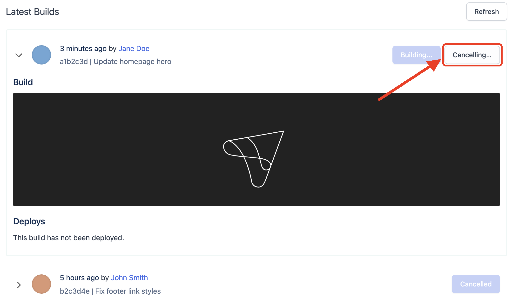
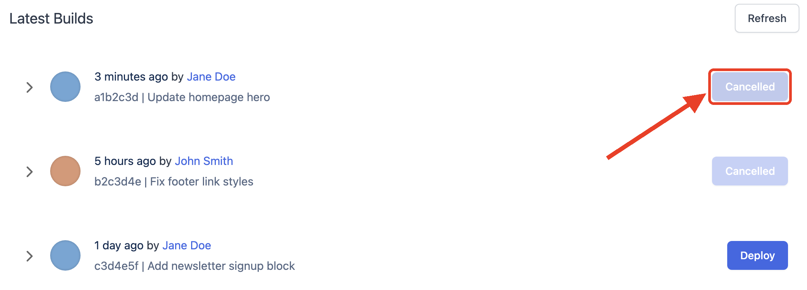

# Builds

The Altis Dashboard shows the latest builds and deploys for each environment. When you push to an environment's tracked branch,
Altis builds your commit using your [build script](../build-scripts/).

You can find these under the **Release** tab of the selected Altis Environment.

## Cancelling a build

Builds that are still in progress can be cancelled. This is useful if a build was started by mistake, or if you have pushed a fix
and don't want to wait for an older build to finish.

1. In the Altis Dashboard, go to the **Release** tab of the environment.
2. The in-progress build is expanded automatically under **Latest Builds**.
3. Click **Cancel build**.

The button changes to **Cancelling…** while the build is stopped.

Once stopped, the build is marked as **Cancelled** and kept in the build history. Cancelled builds cannot be deployed. To build
the branch again, expand **Advanced actions** and click **Force Rebuild**. This builds the latest commit on the branch.

**Note:** The build is cancelled as soon as you click **Cancel build**, without a confirmation step. Cancelling a build does not
affect the code currently deployed to the environment.

Cancelling builds requires the Developer or Admin role. See [Teams](./teams.md#developer) for more information.
