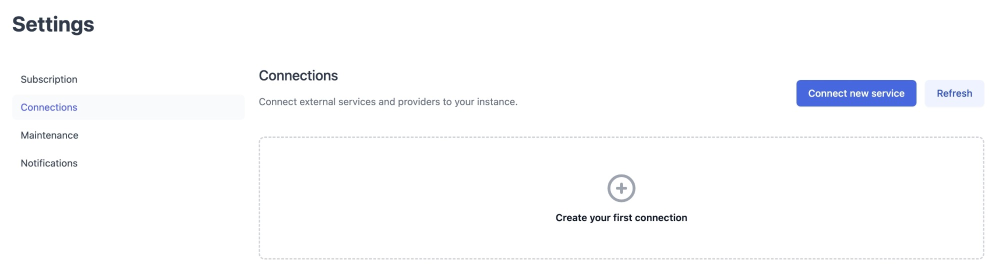
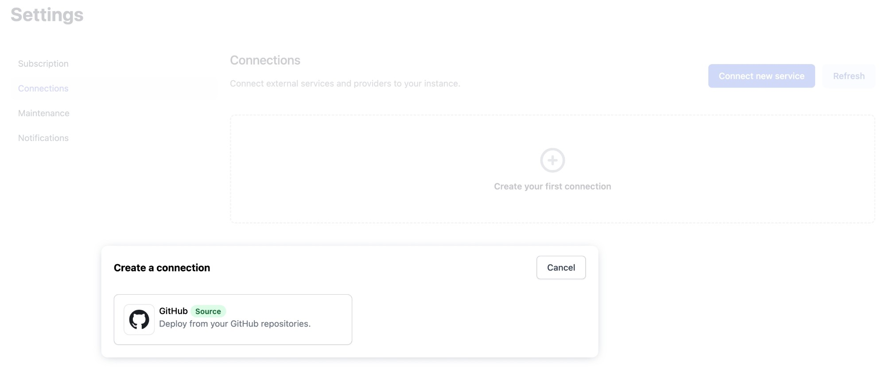
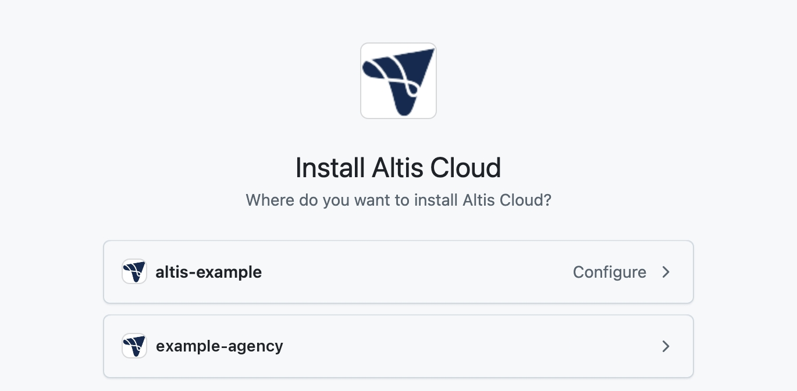
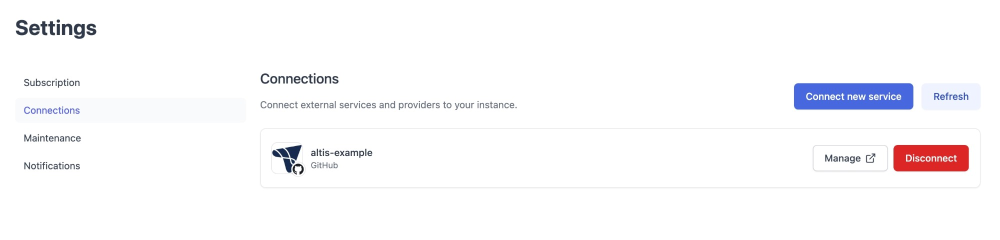
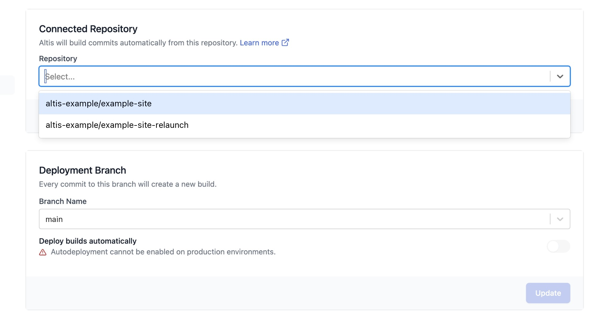
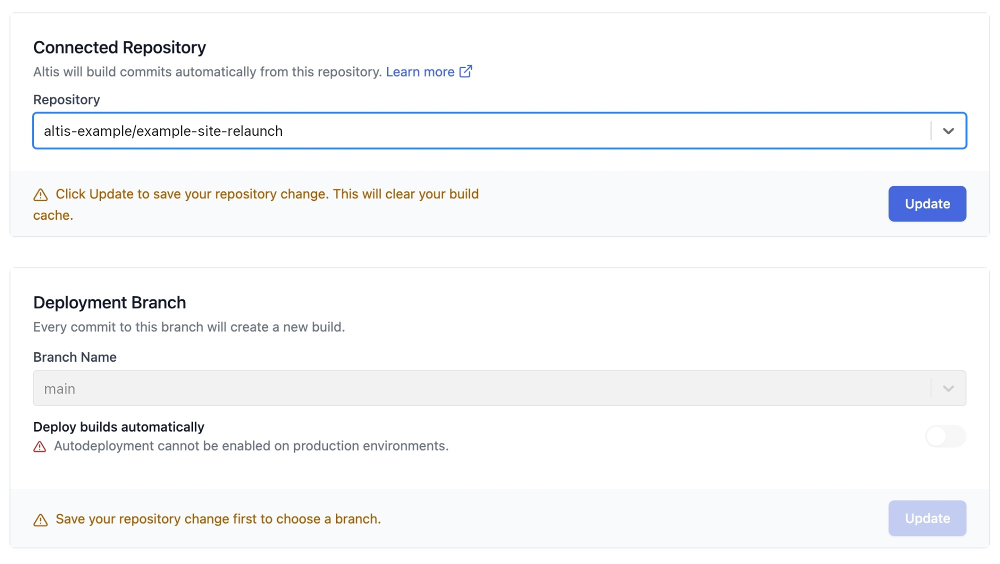
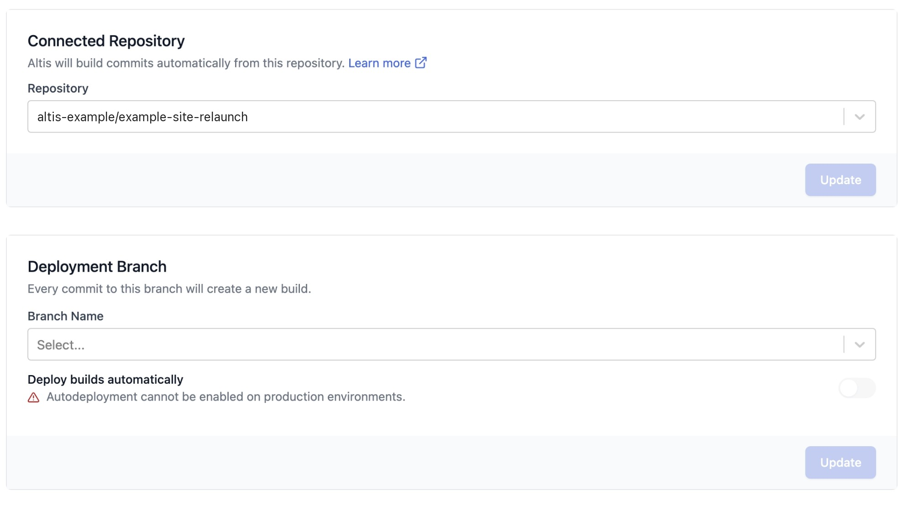
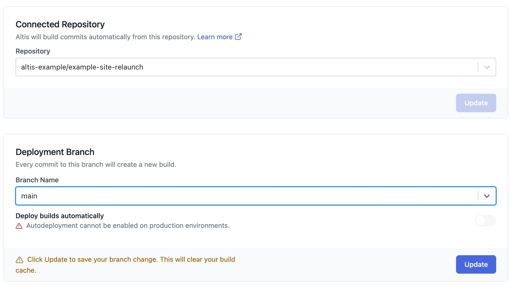
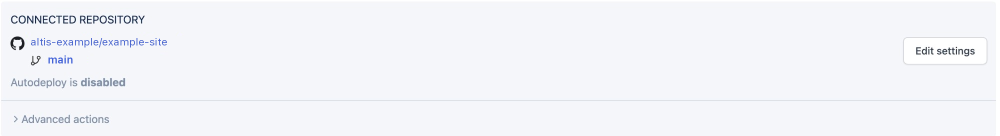
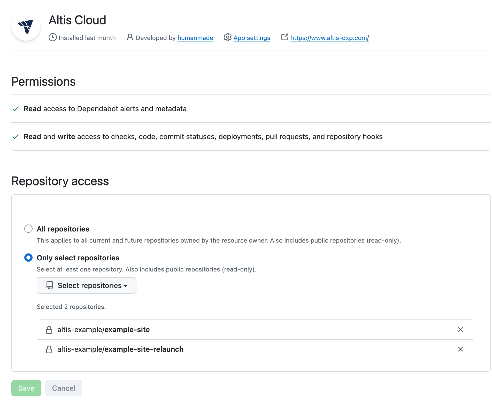

# Connections

Connections link your Altis Instance to outside services. Today, you can use a connection to link your GitHub organization, so
Altis can build and deploy from your repositories.

GitHub connections use the Altis Cloud GitHub app. The app replaces the older setup, where you had to add the
[@humanmade-cloud](https://github.com/humanmade-cloud) user to your repository and install the AWS Connector for GitHub app.

With the Altis Cloud app:

- You choose which repositories Altis can access, and you can change this at any time.
- Each Instance can only access repositories in the GitHub organization it is connected to.
- You can change the repository and branch for an environment yourself, from the Altis Dashboard.
- Pushes to your deploy branch start a new build automatically, the same as before.

If you don't see the **Connections** page in your Instance settings, it is not yet turned on for your Instance.
[Contact Altis support](support://new) to request access.

## Before you start

You will need:

- **Admin** access to the Instance in the Altis Dashboard. See [Team Management](docs://cloud/dashboard/teams/).
- Permission to install GitHub apps on your GitHub organization. This is usually an organization owner. If you are not an owner,
  GitHub will send your request to an owner to approve.

## Connect your GitHub organization

1. Log in to the Altis Dashboard and select your Instance.
2. Open the Instance **Settings**, then select **Connections**.

   

3. Select **Connect new service**, then select **GitHub**.

   

4. GitHub will ask you to install the Altis Cloud app. Choose the organization that owns your repository.

   

5. Choose which repositories the app can access:
   - **All repositories** gives Altis access to every repository in the organization, including ones you add later.
   - **Only select repositories** gives Altis access to the repositories you pick. Include your project repository and any
     private repositories your build needs (see [Private dependencies](#private-dependencies)).
6. Select **Install** (or **Save**, if the app is already installed on the organization).

GitHub will send you back to the Connections page, where your organization now appears in the list.

If your organization already has the Altis Cloud app installed (for example, for another Altis Instance), you will be asked to
confirm the existing installation. Check that the repositories you need are selected, then save.

## Choose the repository and branch for an environment

Once your organization is connected, set the repository for each environment:

1. In the Altis Dashboard, select the environment.
2. Open the environment **Settings**, then select **Deployment**.
3. Under **Connected Repository**, choose your repository from the list.

   

4. Select **Update** to save the repository. You must save a repository change before you can choose a branch.

   

5. Under **Deployment Branch**, choose the branch this environment should deploy from. After a repository change, the previous
   branch is cleared, so you need to choose it again.

   

6. Select **Update** to save the branch.

   

Once both are saved, the environment's **Deploys** page shows the connected repository and branch.

Every commit pushed to the chosen branch creates a new build.

Changing the repository or the branch clears the environment's build cache, so the next build may take longer than usual.

Only repositories the Altis Cloud app can access appear in the list. If a repository is missing, see
[Manage repository access](#manage-repository-access).

## Manage repository access

To add or remove repositories, or to review the app's permissions:

1. Go to **Settings** > **Connections** for your Instance.
2. Select **Manage** next to your GitHub connection. This opens the app's settings on GitHub.
3. Under **Repository access**, update the repository list, then select **Save**.

   

4. Return to the Connections page and select **Refresh**.

You need to be an owner of the GitHub organization to change these settings. If GitHub shows a 404 error when you select
**Manage**, you don't have permission to manage apps on that organization. Ask an organization owner to make the change.

If you remove access to a repository that an environment deploys from, builds for that environment will fail until you restore
access or choose another repository.

## Private dependencies

During a build, Altis can access any repository the Altis Cloud app can access in your connected organization. This includes
private Composer packages, npm packages, and Git submodules hosted on GitHub.

To use a private dependency:

- Make sure the repository is in the same GitHub organization as your connection.
- Make sure the repository is included in the app's repository access (see [Manage repository access](#manage-repository-access)).
- Reference the repository with an HTTPS URL, for example `https://github.com/example-org/example-package.git`. SSH URLs such as
  `git@github.com:example-org/example-package.git` will not work with the Altis Cloud app.

Altis cannot access private repositories in other GitHub organizations through this connection. For those, use a build secret
with an access token. See [Private dependencies](docs://cloud/build-scripts/private-dependencies/).

## Disconnect GitHub

To remove a connection, go to **Settings** > **Connections** and select **Disconnect** next to it.

Environments that deploy from repositories in that organization may stop building. Choose a new repository for each
affected environment before disconnecting, or connect again afterwards.

Disconnecting in the Altis Dashboard does not uninstall the app from GitHub. To remove it completely, uninstall the Altis Cloud
app from your organization's settings on GitHub.

## Switching from the humanmade-cloud user

If your environments currently deploy using the `@humanmade-cloud` user, they will keep working as they are. Nothing changes
until you choose a repository through a connection.

To switch:

1. [Connect your GitHub organization](#connect-your-github-organization).
2. [Choose the repository and branch](#choose-the-repository-and-branch-for-an-environment) for each environment.
3. Push a commit to each environment's branch and check the build starts and succeeds.
4. Once every environment in the Instance is switched, you can remove the `@humanmade-cloud` user from your repositories, and
   uninstall the AWS Connector for GitHub app if no other services use it.

If you have any problems while switching, [contact Altis support](support://new).
